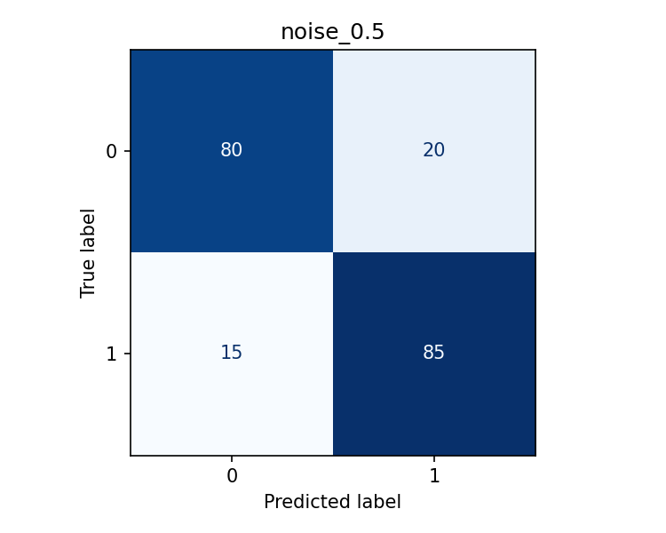
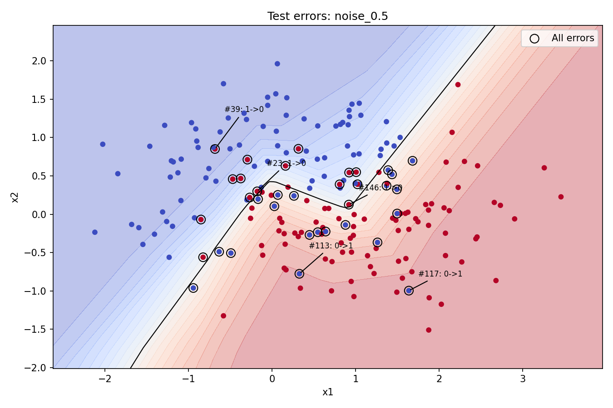

# noise_0.5：错误样本分析

混淆矩阵行是真实类别，列是预测类别；类别顺序为0、1。
矩阵：[[80, 20], [15, 85]]。200个测试样本中分错35个。
真实0错分为1：20个；真实1错分为0：15个。

编号为测试集内从0开始的索引。圈出所有错误，标注最多5个，包括概率最接近0.5和最远离0.5的错误。
P(类别1)是模型输出，未经概率校准，不代表实际正确率。

## 样本 #146
坐标(0.9190, 0.1254)；真实1，预测0；P(类别1)=0.4744。
输出接近分类阈值0.5，模型对分类不确定；这不是到边界的几何距离。
最近的10个其他测试点中，有3个属于另一真实类别。局部标签混杂，支持类别重叠可能参与误判的解释。
上述统计只提供线索，不能断定该点一定由噪声造成，也不能据此认定标签错误。

## 样本 #23
坐标(-0.1768, 0.2985)；真实1，预测0；P(类别1)=0.4706。
输出接近分类阈值0.5，模型对分类不确定；这不是到边界的几何距离。
最近的10个其他测试点中，有5个属于另一真实类别。局部标签混杂，支持类别重叠可能参与误判的解释。
上述统计只提供线索，不能断定该点一定由噪声造成，也不能据此认定标签错误。

## 样本 #39
坐标(-0.6820, 0.8509)；真实1，预测0；P(类别1)=0.0222。
输出明显偏向错误类别，说明模型也会对错误判断给出较强倾向。
最近的10个其他测试点中，有9个属于另一真实类别。局部标签混杂，支持类别重叠可能参与误判的解释。
上述统计只提供线索，不能断定该点一定由噪声造成，也不能据此认定标签错误。

## 样本 #117
坐标(1.6371, -0.9962)；真实0，预测1；P(类别1)=0.9731。
输出明显偏向错误类别，说明模型也会对错误判断给出较强倾向。
最近的10个其他测试点中，有10个属于另一真实类别。局部标签混杂，支持类别重叠可能参与误判的解释。
上述统计只提供线索，不能断定该点一定由噪声造成，也不能据此认定标签错误。

## 样本 #113
坐标(0.3276, -0.7764)；真实0，预测1；P(类别1)=0.9543。
输出明显偏向错误类别，说明模型也会对错误判断给出较强倾向。
最近的10个其他测试点中，有9个属于另一真实类别。局部标签混杂，支持类别重叠可能参与误判的解释。
上述统计只提供线索，不能断定该点一定由噪声造成，也不能据此认定标签错误。
