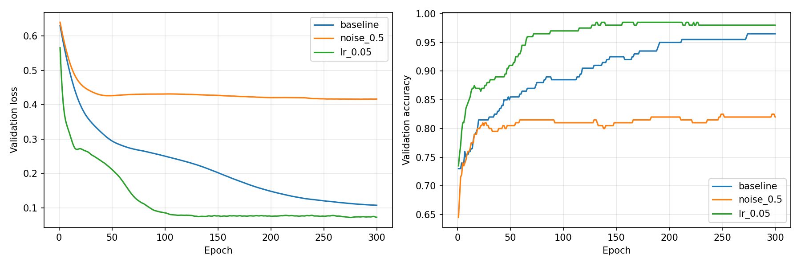

# 三组单变量对照实验

共同条件：种子42，1000个样本，600/200/200划分，2→16→1，ReLU，Adam，全批次，300轮，CPU。
每组重新初始化，使用最低验证损失的模型进行最终测试。

| 实验 | 噪声 | 学习率 | 最佳轮数 | 验证loss | 测试准确率 | 耗时(s) | 每轮(ms) | GPU显存 |
|---|---:|---:|---:|---:|---:|---:|---:|---|
| baseline | 0.2 | 0.01 | 300 | 0.1077 | 98.00% | 0.961 | 3.202 | 不适用(CPU) |
| noise_0.5 | 0.5 | 0.01 | 284 | 0.4159 | 82.50% | 0.618 | 2.059 | 不适用(CPU) |
| lr_0.05 | 0.2 | 0.05 | 275 | 0.0723 | 97.00% | 0.621 | 2.070 | 不适用(CPU) |

计时包含训练、验证、训练集评估、检查点保存和循环内打印；不包含数据生成、最终测试和绘图。
单次计时受首次运行开销、磁盘和系统负载影响，不能把微小速度差异直接归因于实验因素。
噪声组改变了训练、验证和测试的数据难度，准确率降低不等于算法本身变差。
CPU实验不使用GPU显存。固定种子不能保证跨软件版本和设备的结果完全相同。
各组目录保存模型、完整300轮指标、数据图、训练曲线和决策边界。

## 混淆矩阵与错误样本
- [baseline：错分4个，查看具体分析](baseline/error_analysis.md)
- [noise_0.5：错分35个，查看具体分析](noise_0.5/error_analysis.md)
- [lr_0.05：错分6个，查看具体分析](lr_0.05/error_analysis.md)