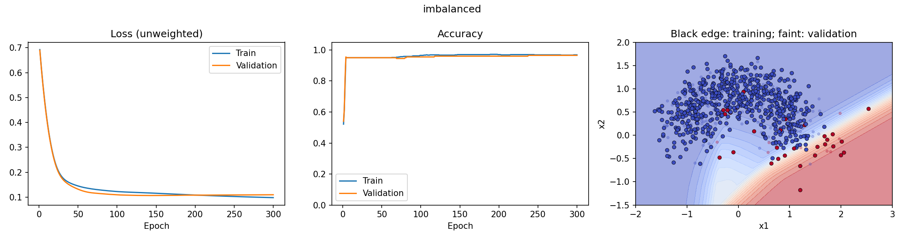
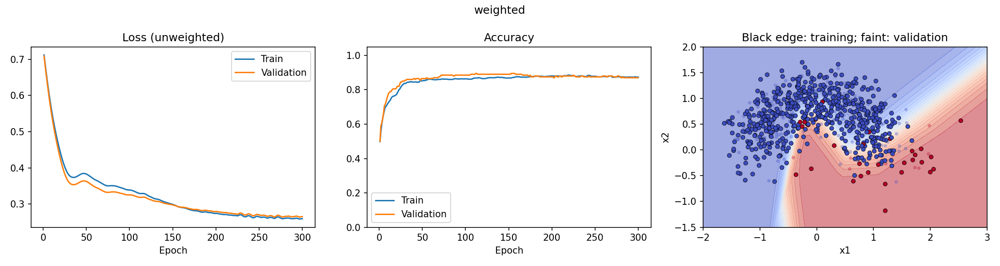
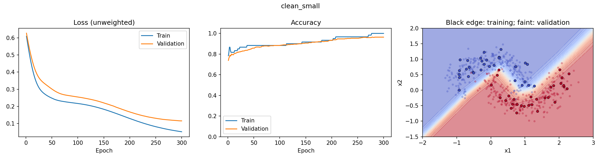
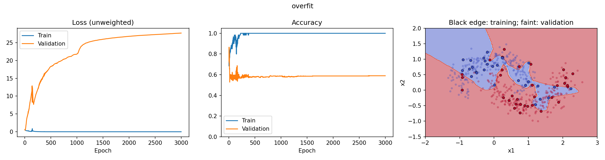

# make_moons 二分类任务思考

## 1. 我选择了什么激活函数，为什么？

本任务隐藏层选择 **ReLU**：`nn.ReLU()`，公式为 `ReLU(x)=max(0,x)`。网络结构是 `2 → 16 → 1`：输入是点的两个坐标，隐藏层有16个神经元，输出一个二分类分数。

选择它的主要原因是引入非线性。两个月牙交错，单条直线通常无法很好地分开它们。如果只堆叠线性层而没有非线性激活函数，多层运算仍等价于一个仿射变换，不能充分表达这种弯曲边界。ReLU计算简单，在正区间导数为1，不像Sigmoid那样在较大的正输入处进入饱和区，适合这个小型MLP。

ReLU也有局限：负区间梯度为0，一些神经元可能长期不激活。它并不是所有任务中都最优，也不能保证网络完全没有梯度问题。

输出层没有再接ReLU或Sigmoid，而是输出原始分数logit。训练时损失函数内部处理Sigmoid；预测时再通过 `torch.sigmoid(logits)` 得到类别1的分数，以0.5为阈值分类。

## 2. 我选择了什么损失函数？三分类怎么办？

本任务使用 **`nn.BCEWithLogitsLoss()`**。因为每个样本只属于0或1中的一类，模型每个样本输出一个logit，所以二元交叉熵适合这个任务。这个函数把Sigmoid与二元交叉熵结合起来计算，比手工先算Sigmoid再取对数更数值稳定。

二元交叉熵可理解为：真实标签是1时，希望预测的类别1概率接近1；标签是0时，希望这个概率接近0。尤其会惩罚“非常自信却预测错误”的情况。

当前模型输出形状是 `(N,1)`，标签也转换为 `(N,1)`，标签类型是浮点数。不要在模型末尾再加一个Sigmoid后传给BCEWithLogitsLoss，否则相当于重复处理。

如果改成**三个互斥类别**，应把输出层改成3个输出，并使用多分类交叉熵：

```python
model = nn.Sequential(
    nn.Linear(2, 16),
    nn.ReLU(),
    nn.Linear(16, 3),
)
criterion = nn.CrossEntropyLoss()
labels = labels.long().reshape(-1)  # (N,)，取值0、1、2
logits = model(inputs)             # (N,3)
loss = criterion(logits, labels)
predictions = logits.argmax(dim=1)
```

训练时不必先对logits做Softmax，CrossEntropyLoss内部已经包含对应处理。需要展示概率时再用 `torch.softmax(logits, dim=1)`。另外，make_moons本身只有两类，真正做三分类还需要换数据生成方法。如果一个样本可同时属于多个类别，则是多标签任务，不应直接照搬上述互斥三分类方案。

## 3. 三个优化步骤分别做什么？不清空梯度会怎样？

```python
optimizer.zero_grad()
logits = model(X_train)
loss = criterion(logits, y_train)
loss.backward()
optimizer.step()
```

| 操作 | 作用 | 是否更新参数 |
|---|---|---|
| `optimizer.zero_grad()` | 清除上次保存的参数梯度；实现上也可能把梯度设为None | 否 |
| `loss.backward()` | 用链式法则反向传播，计算损失对参数的梯度，并累加到 `.grad` | 否 |
| `optimizer.step()` | 按Adam等优化算法，利用梯度及优化器状态更新权重和偏置 | 是 |

PyTorch默认会累加梯度。如果忘记清空，当前梯度会叠加之前迭代的梯度，更新方向和幅度就不再对应当前这一步的损失，可能导致震荡或不收敛。尤其旧梯度来自旧参数位置，不能简单理解为“加速训练”。

有时会有意累积多个小批次的梯度来模拟较大批次，但需要安排何时清空、何时更新，并适当缩放损失。这与无意忘记清空不同。

## 4. 网络越深、越宽一定越好吗？

不一定。深度、宽度增加会提高表达能力，也通常增加参数量、计算量和内存需求，但最终效果还受数据量、噪声、优化方法和正则化影响。

- **太简单：可能欠拟合。** 连训练集规律也没学好，训练与验证效果都较差。例如没有非线性能力的模型难以拟合月牙边界。
- **太复杂：可能过拟合。** 学会了训练数据的偶然噪声，训练表现很好，验证和测试表现却不好。也可能更难优化或训练更慢。

复杂模型并非必然过拟合，简单模型也不是绝对不会过拟合。需要同时检查训练与验证指标。当前基准MLP只有65个参数，却能取得98%的测试准确率，说明这个任务不一定需要很大的网络。

## 5. 学习率过大或过小有什么表现？

学习率控制更新幅度，但Adam实际更新还受动量和自适应缩放影响。

- 过小：loss下降很慢，在固定训练轮数内可能尚未充分收敛，accuracy提升也慢。
- 合适：loss总体下降，验证效果逐渐改善。
- 过大：可能跳过较好的区域，loss反复震荡、突然升高，严重时出现非有限值；不一定每次都会发生。

本任务此前实际结果如下（每组300轮，按最低验证loss选择模型）：

| 配置 | 最佳验证loss | 测试loss | 测试accuracy |
|---|---:|---:|---:|
| noise=0.2，lr=0.01 | 0.1077 | 0.0805 | 98.0% |
| noise=0.2，lr=0.05 | 0.0723 | 0.0630 | 97.0% |
| noise=0.5，lr=0.01 | 0.4159 | 0.3903 | 82.5% |

在本次实验中，0.05并没有导致发散，验证loss下降更快。因此不能仅因为它比0.01大，就叫它“过大”。测试loss更低但accuracy略低也不矛盾：loss反映概率分数，accuracy只看是否跨过0.5阈值，200个样本中多错2个就会下降1个百分点。

仅凭训练loss下降不能证明泛化变好。若训练loss继续下降而验证loss持续升高，应考虑过拟合。原实验计时还包含验证、保存和打印，不能把总耗时差直接等同于收敛速度差。

## 6. 类别严重不均衡会怎样？实际试验

当多数类远多于少数类时，普通平均损失容易被多数类主导；少数类样本又少，规律更难学全，模型可能偏向多数类。比如95%的样本是0类，全部预测0就能获得95%准确率，却一个1类都识别不出。这说明**整体准确率不能独自衡量不均衡分类的效果**。

### 实验设置

使用 `make_moons(n_samples=(950,50), noise=0.3, random_state=42)`，0类950个、1类50个。分层划分后训练集570:30，验证集190:10，测试集190:10。MLP仍为2→16→1、ReLU、Adam、lr=0.01、300轮，种子42、CPU。

比较普通BCEWithLogitsLoss与 `BCEWithLogitsLoss(pos_weight=torch.tensor([19.0]))`。19来自训练集负类与正类之比570/30。只改变损失加权，两组均使用最后一轮模型，不利用测试集调参。图中的loss统一使用**未加权**交叉熵，便于比较。

### 实测结果

| 模型 | 测试accuracy | 0类召回率 | 1类召回率 | 平衡准确率 |
|---|---:|---:|---:|---:|
| 全部预测0（参照规则） | 95.0% | 100% | 0% | 50.0% |
| 普通损失 | 96.0% | 99.47% | 30.0% | 64.74% |
| 正类加权19 | 87.5% | 87.37% | 90.0% | 88.68% |

平衡准确率是两类召回率的平均值。普通模型混淆矩阵为 `[[189,1],[7,3]]`，加权模型为 `[[166,24],[1,9]]`；行是真实类别，列是预测类别。

普通模型虽然accuracy达到96%，但10个少数类只识别出3个。加权后识别出9个，代价是更多多数类被误判，所以整体accuracy降低。这不是无条件“变好”或“变差”，要根据漏检和误报的代价选择指标与方案。这里只有10个少数类测试样本，召回率一次变化就有10个百分点，结论存在较大抽样不确定性。





除了类别加权，还可考虑补充少数类数据、仅对训练集重采样、根据验证集调整分类阈值，并报告混淆矩阵、各类precision/recall、F1或PR曲线。重采样必须在划分之后只针对训练集，避免数据泄漏。测试集不参与这些选择。

## 7. 如果想故意过拟合，怎么做？是否实现？

### 方法与原因

训练数据少、模型容量大、缺少正则化并训练很久，会使模型更容易记忆训练细节。为了明确演示“记忆错误答案”，本次还只对训练标签人为加噪声：生成1000个月牙样本（坐标noise=0.2），划分为训练60、验证470、测试470，随机将15个训练标签翻转。验证和测试保持原始标签。

使用 `2→128→128→128→1` 的ReLU网络，Adam、lr=0.01，训练3000轮，不加Dropout、权重衰减或早停，并刻意评估最后一轮，而不是恢复验证表现最好的模型。

这是为了制造现象而同时改变多个条件的**演示实验**，不是一次只改一个变量的因果对照。不能据此声称某一因素单独造成了全部性能差异，也不能把人为标签污染当作正常数据处理方式。

另保留相同60个训练坐标、原始标签、单隐藏层16宽、300轮的小模型作为清洁数据参照。

### 实测结果

| 实验 | 训练loss | 训练accuracy | 验证loss | 验证accuracy | 测试accuracy |
|---|---:|---:|---:|---:|---:|
| 清洁标签、小模型 | 0.0516 | 100% | 0.1151 | 96.38% | 95.74% |
| 标签污染、大模型、长训练 | 约1.39×10⁻⁷ | 100% | 27.6851 | 58.94% | 61.28% |

**成功观察到了明显过拟合。** 大模型把60个训练样本（包括15个错误标签）全部记住，但在新样本上表现很差。其验证loss最低出现在第4轮，为0.4387，最终升至27.6851，而训练loss接近0。这个随训练进行而扩大的差距，比单看一次测试分数更能说明问题。

交叉熵没有上限。验证loss很大，是因为模型对一些错误答案给出了非常极端的logit；它不等于“错误率超过100%”。





图中黑边点为训练点，淡色点为验证点，背景表示预测类别1的概率。正常参照学到的边界与月牙整体结构较一致；过拟合模型为满足少量被翻转的训练标签，形成更多不符合总体分布的分类区域。

我判断过拟合的依据是：训练集拟合极好、验证与测试明显较差，以及训练继续进行时验证loss恶化。**训练accuracy为100%本身不是充分证据**：清洁标签的小模型也达到100%，却仍有较好的验证效果。也不能只凭边界弯曲就认定过拟合，因为月牙本来就需要非线性边界。

实际任务中会优先检查标签质量、增加有效数据、控制容量、使用正则化，并依据验证集早停。测试集仅在方案确定后做最终评估。


保存内容：results.json为汇总；四张PNG为训练曲线及数据边界；四份history.npy为逐轮指标（依次为训练loss、验证loss、训练accuracy、验证accuracy）；overfit_data.npz保存原始及污染后的训练标签和划分后的数据，方便核对。
