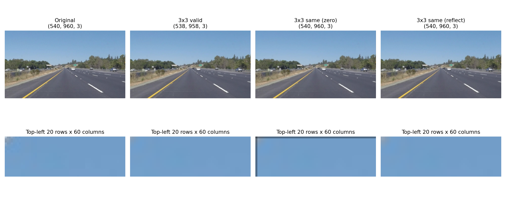
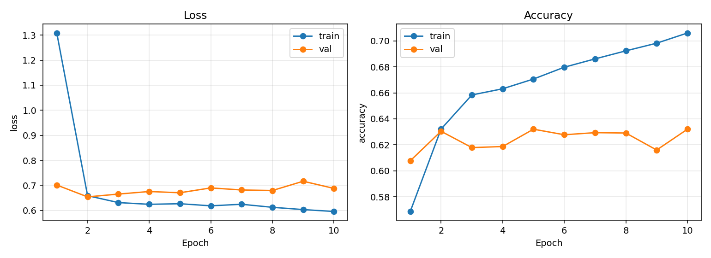

# 一、了解数字图片如何被表示，并回答：像素是什么？什么是 RGB？灰度图和彩色图有什么区别？
**像素**：像素是构成数字图像的最小单位，每个像素都包含一个特定的颜色值。一个像素一个小方块，每个方块上是描述该方块颜色和亮度的数值。
**RGB**:RGB是一种颜色模型，由红、绿、蓝三种颜色组成，每种颜色都有256个等级，通过三种颜色的组合可以表示出16777216种颜色。
**灰度图和彩色图的区别**：灰度图只有黑白两种颜色，而彩色图有RGB三种颜色，彩色图可以表示出更多的颜色。
# 二、说明每个维度和数值分别表示什么，以及 NumPy/Pillow 常见的 HWC 与 PyTorch 常见的 CHW 排列有什么区别？
|              |                                        |
|--------------|----------------------------------------|
| `H = 540`    | 高度：图片有 540 行像素                |
| `W = 960`    | 宽度：每行有 960 个像素                |
| `C = 3`      | 通道数：红色 R、绿色 G、蓝色 B         |
| `uint8`      | 8 位无符号整数，能表示 `0～255`        |
| 最大值 `255` | 整张图片所有像素、所有通道中的最大数值 |
| 最小值 `16`  | 整张图片所有像素、所有通道中的最小数值 |


| 排列 | 维度顺序      | 这张图片的 shape | 读取一个像素的 RGB |
|------|---------------|------------------|--------------------|
| HWC  | 高、宽、通道  | `(540, 960, 3)`  | `arr[y, x, :]`     |
| CHW  | 通道、高、宽  | `(3, 540, 960)`  | `tensor[:, y, x]`  |
HWC：先找到第几行、第几列，再取这个像素的 RGB。
CHW：先选红、绿、蓝中的一个通道，再找到这个通道的第几行、第几列。

# 三、卷积核是什么？它在图片上怎样移动？每到一个位置进行了什么计算？
**卷积核**：卷积核就是一个小的数字矩阵，里面的数字是权重，不同的权重以用来提取不同的图像特征，比如边缘、纹理。
通常从图片左上方开始，从左往右移动，走完一行后向下移动，再扫描下一行。 每次移动的距离叫作步长(stride),stride=1,即每次走一个像素格，如果要处理图片边缘，或者
控制输出尺寸，可以在图片周围补一些数值，一般是零，即填充。
**计算方法**:对应位置相乘，再把所有乘积加起来。

# 四、观察并解释不同卷积核对图片的影响

本次使用同一张公路图片 `image/img.png`，调用手写 NumPy 卷积函数进行处理。均值、高斯和锐化分别处理 RGB 三个通道；Sobel 先转为灰度图再计算。


## 4.1 均值模糊：为什么会模糊？

使用 3×3 卷积核，九个位置的权重都是 `1/9`：

```text
1/9  1/9  1/9
1/9  1/9  1/9
1/9  1/9  1/9
```

**观察：** 相比原图，树木的细碎纹理、车辆轮廓和车道线边界变得柔和，细节不如原来清楚；天空等颜色变化缓慢的区域变化较小。

**原因：** 输出像素是周围九个像素的平均值。例如白色车道线旁边是较暗的路面，取平均后，白线边缘的亮度降低，附近暗像素的亮度提高，原本明显的亮暗分界变成较平缓的过渡，所以看起来模糊。

平均运算能减弱局部随机波动，也会减弱真实细节。从频率角度看，它抑制快速变化的高频信息，属于平滑或低通滤波。模糊并不是把图片像素数量变少了：本次使用 same 填充，结果仍然是 540×960 像素。

## 4.2 高斯模糊：为什么也会模糊？与均值有什么区别？

使用 5×5 高斯卷积核，取 `σ=1`，根据下面的函数生成权重：

\[
G(x,y)=\exp\left(-\frac{x^2+y^2}{2\sigma^2}\right)
\]

其中 x、y 是相对卷积核中心的偏移，均取 -2、-1、0、1、2。计算后再除以全部权重之和，使权重总和为 1。由于做了归一化，可以省略高斯函数前面的常数系数。

**观察：** 高斯结果中的车道线和树木细节同样变得柔和，局部明暗过渡比较平滑。原图的整体道路结构和颜色仍然保留。

**原因：** 高斯滤波也是邻域平均，但采用加权平均：越靠近中心的像素权重越大，越远的像素权重越小。相邻像素的值被混合后，亮度突变被平滑，因此也会模糊。

均值核对窗口内各位置一视同仁，高斯核更重视靠近中心的位置。高斯也会模糊边缘，并不意味着它能完全保留边缘。本次比较的是 3×3 均值与 5×5、σ=1 的高斯，核大小和权重形式都不同，不能只根据这一次结果断言高斯一定更模糊或一定更清晰。高斯的平滑程度与 σ 及核大小都有关系。

## 4.3 锐化：为什么边缘更明显？

使用卷积核：

```text
 0 -1  0
-1  5 -1
 0 -1  0
```

**观察：** 车道线、树木和车辆的轮廓更突出，画面局部对比更强，细小纹理也更加明显。但增强后的纹理不一定都是有用细节，噪声也可能一起被放大。

**原因：** 对某个中心像素，计算过程是：

```text
输出 = 5×中心 - 上 - 下 - 左 - 右
     = 中心 + (4×中心 - 上 - 下 - 左 - 右)
```

括号内表示中心像素与四邻域的差异。在亮度均匀的区域，中心与邻居相等，这一项为 0，输出基本不变。在边界附近，中心与邻居不同，这个差异会被加回原像素：较亮一侧可能更亮，较暗一侧可能更暗，从而增强边缘附近的对比。

因此锐化不是凭空恢复已经丢失的信息，而是增强已有的局部变化。增强过强可能出现亮暗光晕或噪声。计算结果可能小于 0 或大于 255，程序保留浮点原始结果，只在保存显示图片时裁剪到 0～255，避免直接转成 uint8 导致错误数值。

## 4.4 Sobel：为什么能够找到边缘？

边缘通常对应亮度发生较快变化的位置，例如天空与树林、白色车道线与深色路面之间。Sobel 通过估计亮度的空间梯度来找这些位置。

```text
Sobel-X            Sobel-Y
-1  0  1           -1 -2 -1
-2  0  2            0  0  0
-1  0  1            1  2  1
```

**Sobel-X：** 右侧亮度减去左侧亮度，并结合上下邻近行的加权结果。左右亮度接近时相互抵消，结果接近 0；左右差异大时，结果绝对值较大。因此它检测沿水平方向的变化，对竖向边缘更敏感。

**Sobel-Y：** 下侧亮度减去上侧亮度，检测沿竖直方向的变化，对横向边缘更敏感。这里图片纵坐标向下增加。

两个核的权重总和都是 0，所以在恒定亮度区域输出为 0。权重中的 1、2、1 还相当于在与求差分方向垂直的方向上做局部加权平滑，减弱一些噪声影响，但不能消除所有噪声。

**观察：** 天空和较平坦路面大部分接近黑色；车道线、护栏以及树林与天空交界等位置出现较亮响应。两个方向突出的位置有所不同，斜车道线在两个方向上都可能产生响应。Sobel 检测的是亮度变化，不会理解“这是车”或“这是道路”，树叶纹理和噪声也可能被检测出来。

### 如何合成两个方向？

\[
M=\sqrt{G_x^2+G_y^2}
\]

用梯度幅值合成后，水平、竖直和倾斜边缘都能得到体现。不能简单相加，否则正负值可能抵消。梯度符号反映变化方向，幅值反映变化强弱；幅值并不是边缘存在的概率。

方向图显示 `|Gx|`、`|Gy|`，合成图显示 M。三张图共用由 M 的最大值确定的缩放比例再映射到 0～255。原始带符号梯度保存在 `filter_results/raw_results.npz`，因此显示时取绝对值不会丢掉保存的数据。

## 4.5 本实验的边界与计算约定

- 使用零填充保持尺寸。图片外部被当作黑色，可能让模糊图外沿变暗、Sobel 图外沿出现额外响应，这不是原场景中的真实边缘。
- 调用 `flip_kernel=False`，使用互相关形式。均值、高斯、锐化核对称，翻转与否结果一致；这里的 Sobel 核翻转后梯度符号相反，但绝对值和合成边缘幅值不变。
- 全部核心滤波由手写 NumPy 函数执行，没有调用现成的卷积或滤波实现。

# 五、valid、same、步长与输出尺寸

配套脚本为 `padding_comparison.py`，使用同一张540×960的RGB图片，分别测试3×3、5×5均值核，stride=1、2及valid、same零填充。所有输出和浮点数据保存在 `padding_results`。

## 5.1 输出尺寸公式

不使用膨胀卷积时，高度方向满足：

\[
H_{out}=\left\lfloor\frac{H+P_{top}+P_{bottom}-K_h}{S_h}\right\rfloor+1
\]

宽度方向满足：

\[
W_{out}=\left\lfloor\frac{W+P_{left}+P_{right}-K_w}{S_w}\right\rfloor+1
\]

H、W为输入高宽，Kh、Kw为核高宽，P为各侧填充数量，S为步长；向下取整表示只计算放得下完整窗口的位置。RGB逐通道滤波时通道数仍是3。

- **valid**：各侧P=0，不人为增加边界像素。卷积核必须完整放在图像内，通常使输出变小。
- **same**：本函数采用输出高宽为 `ceil(H/S)`、`ceil(W/S)` 的约定。只有stride=1时才与原图高宽相同。
- same所需总高度填充为 `max((Hout-1)×S+Kh-H, 0)`，宽度同理。总数为奇数时，本函数把多出来的一行或一列放在下方或右侧。
- 奇数核、stride=1时，每侧填充 `(K-1)/2`，所以3×3核各补1，5×5核各补2。stride>1时不能直接套用这个简化规则。

本次配置对应的尺寸如下，脚本会逐项断言实际尺寸与公式一致：

| 核大小 | stride | padding | 上/下填充 | 左/右填充 | 输出shape（HWC） |
|---|---:|---|---|---|---|
| 3×3 | 1 | valid | 0/0 | 0/0 | (538,958,3) |
| 3×3 | 1 | same | 1/1 | 1/1 | (540,960,3) |
| 5×5 | 1 | valid | 0/0 | 0/0 | (536,956,3) |
| 5×5 | 1 | same | 2/2 | 2/2 | (540,960,3) |
| 3×3 | 2 | valid | 0/0 | 0/0 | (269,479,3) |
| 3×3 | 2 | same | 0/1 | 0/1 | (270,480,3) |
| 5×5 | 2 | valid | 0/0 | 0/0 | (268,478,3) |
| 5×5 | 2 | same | 1/2 | 1/2 | (270,480,3) |

例如3×3、stride=1、valid的输出高度为 `(540-3)/1+1=538`。相同核和填充下，步长变大使输出采样位置变少；相同步长和填充量下，核越大，输出通常越小。same会调整填充来补偿核大小变化。

## 5.2 边缘像素有什么变化？



**valid：** 不使用人为补出的值，因此没有零填充带来的暗边，但不再对原图最外侧的所有像素中心生成输出。3×3、stride=1时，输出左上角对应原图中心位置(行1,列1)，而不是原图(0,0)。因此不能直接将两个输出的 `[0,0]` 当作同一位置比较。

**same零填充：** 能保留stride=1时的高宽，但边缘窗口包含黑色0值。3×3均值核在左上角只有4个真实像素、5个0，仍然除以9，所以会明显变暗。在非角落的顶边通常有6个真实像素，也会变暗。梯度核则可能把图像与外部0值的差异检测成额外边缘。

**公平比较：** 对3×3、stride=1，应比较 `valid` 与 `same[1:-1,1:-1]`；对5×5则裁去same四周各2个像素。脚本使用 `assert_allclose` 检查二者一致，说明零填充影响的是接触边界的窗口，不会改变内部相同位置的计算。

本次3×3、stride=1实测：原图左上像素RGB为 `[181,197,213]`，same零填充输出左上角约为 `[67.44,75.44,84.00]`，反射填充时约为 `[146.33,165.22,185.22]`。valid输出左上角约为 `[139.67,161.56,185.00]`，但它对应原图(1,1)，不能将差值全解释成填充效应。8组输出尺寸检查与两组内部对齐检查均通过。

补充的reflect对比先使用NumPy反射填充，再调用手写valid卷积。这样仍能保留尺寸，且通常不会产生零填充造成的明显暗边。**same决定补多少，zero/reflect决定补什么**，它们是不同概念；任何补值方式都包含对图像外部内容的假设。对比图的valid面板左上角在原图中的位置与其他面板不同。

# 六、结果超出像素范围时怎样保存？

不能不加处理地把卷积结果直接转为uint8，否则负数或过大的数值可能转换成错误的亮度。计算阶段用浮点，并保留原始结果，保存显示图时再按目的处理。

## 6.1 模糊、锐化：保留原有亮度尺度并裁剪

```python
display = np.rint(np.clip(result, 0, 255)).astype(np.uint8)
```

非负且总和为1的均值、高斯核通常不会把0～255的输入推到该范围之外；零填充可能降低边界亮度。锐化含负权重，可能产生负数或超过255的值，显示时需要裁剪。例如-20变为0，280变为255。裁剪会丢失极端数值差别，因此原始浮点结果另存为NPZ。

## 6.2 Sobel：保留符号计算，显示时映射幅值

先用浮点Gx、Gy计算 `np.hypot(Gx, Gy)`，不能先裁掉负梯度再合成。方向图可以显示绝对值，合成图显示幅值，再缩放到0～255。本项目三张边缘图共用同一最大幅值作为缩放尺度，避免各自归一化掩盖强弱差异。

```python
magnitude = np.hypot(gx, gy)
scale = max(float(magnitude.max()), 1e-12)  # 全零图时避免除零
edge_image = np.rint(np.clip(magnitude / scale * 255, 0, 255)).astype(np.uint8)
```

若要看梯度正负方向，可以使用以0为中心的发散色图；取绝对值的灰度显示不保留方向。也可以用min-max归一化显示一般实数结果，但它会改变整体亮度和对比度，不能把这种显示增强误认为滤波本身的效果。若max=min，要单独处理以避免除零。

另外，若原本使用的是0～1浮点图，应按0～1处理后再乘255保存，不能混淆两种数值尺度。

# 七、猫狗 CNN 的思考题

下面的数字对应本项目的 [Microsoft Cats-vs-Dogs 数据集](https://www.kaggle.com/datasets/shaunthesheep/microsoft-catsvsdogs-dataset)。完整的数据检查、代码和其他实验见 `cnn_report.md`、`README_CNN.md`。有效图片共 24966 张，训练/验证/测试分别为 17476/3745/3745 张；本节的 CNN 与全连接对照使用相同划分、输入尺寸、随机种子、batch size、优化器、学习率、无增强设置和 10 轮训练。

## 7.1 为什么图片通常适合卷积？全连接层做这题会怎样？

一张 128×128 的 RGB 图片有 `3×128×128=49152` 个数。直接送入全连接层时，每个隐藏神经元都要连接这 49152 个位置。比如本实验写的全连接模型是 `Flatten → Linear(49152,256) → ReLU → Dropout(0.3) → Linear(256,2)`，仅第一层就需要 `49152×256+256=12583168` 个参数。它会把“左上角的一只耳朵”和“右下角的一只耳朵”当作完全不同的输入位置学习。

卷积层先看很小的局部区域，再把**同一组权重在整张图上重复使用**。本 CNN 第一层的 16 个 3×3 卷积核仅需 `16×3×3×3=432` 个卷积权重（此层设置 `bias=False`）。这样既能在不同位置寻找相似的边缘或纹理，也能用较少参数逐层组合局部特征。卷积对平移具有一定的等变性；再配合池化，可以降低位置变化对分类的影响。但它并非对所有平移都天然保持相同预测。

我实际运行了 `train_fc.py`，使用与无增强 CNN 相同的 128×128 输入、数据划分和训练设置：

| 模型 | 参数量 | 验证准确率（验证 loss 最低的轮次） | 测试准确率 | 10 轮纯训练耗时 | 第 2～10 轮平均纯训练耗时/轮 | GPU 峰值已分配显存 |
|---|---:|---:|---:|---:|---:|---:|
| 全连接 `49152→256→2` | 12,583,682 | 63.04%（第 2 轮） | **63.58%** | 56.10 秒 | 2.65 秒 | 328 MiB |
| 从零训练的无增强 CNN | 360,210 | 89.48%（第 10 轮） | **88.97%** | 59.38 秒 | 3.55 秒 | 503 MiB |

全连接模型约有 CNN 的 **34.93 倍**参数，但本次测试准确率低 **25.39 个百分点**。其训练准确率到第 10 轮升至 70.61%，验证准确率却仍约 63%，呈现泛化差距。CNN 稳定轮次每轮略慢，但分类效果好得多。这里“参数多”不等于“运行时 GPU 显存一定更多”：CNN 训练还需保存较大的中间特征图供反向传播，所以本机观察到 CNN 的峰值已分配显存反而更高。这个结果支持在**本数据、本模型设置和 10 轮预算下**使用 CNN；不能证明所有全连接结构在所有图片任务上都不如 CNN。



可复现实验：`python train_fc.py`；如果训练权重已保存而测试阶段中断，运行 `python evaluate_fc.py` 即可对最佳检查点完成测试，不必重训。详细数字在 `cnn_results/fully_connected/summary.json`。

## 7.2 输入通道、输出通道和卷积核数量是什么关系？

输入通道是上一层给出的特征图张数。第一层输入是 RGB，所以有 **3 个输入通道**；第二层接收第一层的 16 张特征图，所以有 **16 个输入通道**。输出通道是该层产生的特征图张数，由设置的卷积核组数决定。

在本网络第一层 `Conv2d(3,16,kernel_size=3)` 中，可以把它理解为 **16 组**卷积核；每组同时覆盖 3 个输入通道，因此权重形状是 `[16,3,3,3]`，输出 `[N,16,128,128]`。一组核对 R/G/B 分别计算并相加，产生一张输出特征图。第二层 `Conv2d(16,32,3)` 的权重形状则是 `[32,16,3,3]`，会产生 32 张输出图。常说“有 16 个卷积核”指 16 组输出滤波器，并非只存在 16 个独立的 3×3 小矩阵。

## 7.3 padding、stride、pooling 怎样改变尺寸？

单个空间维度的常见计算公式是 `输出 = floor((输入 + 2×padding − 卷积核大小) / stride) + 1`；宽、高各算一次。本 CNN 第一层输入宽高都是 128，使用 3×3 卷积、`padding=1`、`stride=1`，所以宽和高均为 `floor((128+2×1−3)/1)+1=128`，输出 `[N,16,128,128]`。

接着 `MaxPool2d(2)` 默认步长也是 2、不填充，因此每个维度变成 `floor((128−2)/2)+1=64`，输出 `[N,16,64,64]`。下一组卷积保持 64×64，池化再变成 32×32。若第一层卷积改为 `padding=0` 而其余不变，卷积结果将是 126×126；若只把第一层卷积 `stride` 改为 2，则得到 64×64。padding 常用于保留边缘位置与尺寸；增大 stride 会更快下采样；pooling 会汇总邻域并缩小特征图。

## 7.4 为什么高、宽缩小，通道却增多？

本网络的实际变化是 `3×128×128 → 16×64×64 → 32×32×32 → 64×16×16 → 128×8×8`（每个箭头表示一组卷积加最大池化）。前面的层保留较细的位置和颜色/边缘信息，后面的层把邻近特征逐渐组合成更大范围的纹理和形状线索。池化减少空间位置数量，从而降低后续计算量并扩大高层单元能“看到”的原图范围；同时增加输出通道，让网络在每个较粗位置表达更多种模式。**通道变多不代表分辨率变高**，细小的空间信息一旦被下采样也可能丢失，所以不是通道越多越好。

## 7.5 激活函数、损失函数为什么这样选？

隐藏层使用 **ReLU**：把负值变为 0、保留正值，给卷积/全连接堆叠加入非线性，否则多层线性变换仍相当于一次线性变换。ReLU 计算简单，在本实验里能有效训练；它也可能出现某些神经元长期输出 0 的问题。

最后一层输出两个**原始分数**（猫、狗各一个），训练时使用 `CrossEntropyLoss`。它接收未做 softmax 的 logits 和整数标签 `0/1`，衡量正确类别被分配的相对分数，并为错误预测提供梯度。推理时才把两个 logits 经 softmax 转成约和为 1 的两个数，再选较大者作为类别。训练前如果额外先做 softmax 再送入 `CrossEntropyLoss`，会改变其预期输入。另一种同样适合二分类的写法是只输出一个 logit，配合 `BCEWithLogitsLoss`；当前实现使用“两输出＋交叉熵”，代码更方便扩展到多分类。

## 7.6 为什么随机增强只用于训练集？三种变换各有何影响？

训练集随机增强的目的是让模型每次看到略有变化的图片，减少它死记某个朝向、光照或背景。验证集需要固定图片，才能公平比较每一轮或每组实验；测试集也需要固定、独立的图片，才能评价实际泛化。如果验证/测试每次随机变化，同一个模型的分数会受到随机操作影响，难以判断改动是否真有效。训练和推理仍共用**非随机**基础预处理：转 RGB、按比例缩放补边、转 Tensor、归一化。

- **水平翻转**：猫还是猫、狗还是狗，可以增加左右朝向的变化；但如果任务需要区分左/右方向，翻转可能破坏标签。
- **随机裁剪**：能让模型接触不同位置与局部区域；裁剪过重可能把动物头部甚至整只动物裁掉，使原来的猫/狗标签与画面不符。本实验没有使用随机裁剪。
- **颜色变化**：轻微亮度/对比度/饱和度变化能模拟拍摄光照；过强会让毛色和背景失真。本实验只用了较小的扰动。

实际对照中，无增强 CNN 的测试准确率为 **88.97%**；“随机水平翻转＋轻微颜色扰动”组合为 **85.93%**。两组一次改变的是“是否使用这一整套增强”，因此不能单独判断翻转还是颜色变化造成了差距。增强在此设置下没有带来提升，不意味着所有增强都无用。需要进一步拆开变换、调整强度和训练轮数，才好判断原因。
