# 猫狗图像分类实验报告

## 1. 数据来源、检查与观察

本实验使用 [shaunthesheep/microsoft-catsvsdogs-dataset](https://www.kaggle.com/datasets/shaunthesheep/microsoft-catsvsdogs-dataset)，是用户选择的 Microsoft Cats-vs-Dogs 发布版本，不声称与 Kaggle 竞赛原压缩包逐字节相同。标签由 `PetImages/Cat` 和 `PetImages/Dog` 文件夹确定：猫=0，狗=1。

| 统计项 | 猫 | 狗 | 合计 |
|---|---:|---:|---:|
| 原始 JPG 文件 | 12500 | 12500 | 25000 |
| 排除损坏与重复/冲突后 | 12480 | 12486 | 24966 |
| 训练集 | 8736 | 8740 | 17476 |
| 验证集 | 1872 | 1873 | 3745 |
| 测试集 | 1872 | 1873 | 3745 |

逐张执行 Pillow 解码后发现 `Cat/666.jpg`、`Dog/11702.jpg` 无法读取。SHA256 文件内容查重发现 30 个后出现的重复文件；另有两张先出现的图片涉及跨类别重复标注，也整体排除。因此共使用 25000−2−30−2=24966 张。原图片未删除，过滤记录见 `cnn_results/dataset_audit.json`。每个类别还有一个 `Thumbs.db`，不当成图片。

这里的查重是字节级查重；经过重新压缩或裁剪的近似重复图片仍可能存在。分层划分使用固定种子 42，训练/验证/测试约为 70%/15%/15%，并检查三个集合没有相同文件哈希。

有效图片有 7513 种宽高组合，宽、高各自的最小值为 4、最大值为 500，说明不能直接把原始图片堆成 batch。

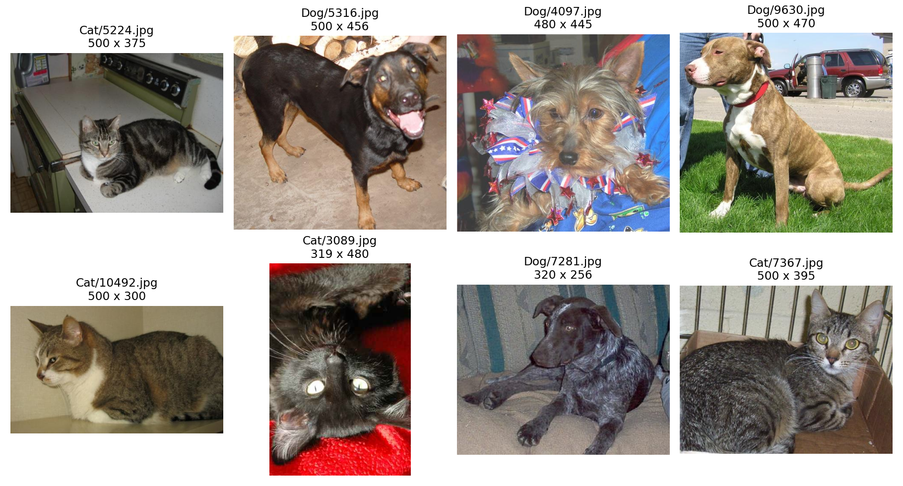

随机样本里有 500×375 的横图、319×480 的竖图、320×256 的小图等。`Dog/7281.jpg` 比一些大图更模糊，深色毛发在暗处不容易看清；`Cat/3089.jpg` 带有明显闪光灯反光。背景包含厨房、沙发、木柴、草地和停车场，动物的大小、姿势和拍摄角度也不一致。因此清晰度、尺寸和背景都不相同，模型需要学会区分动物本身，而不是只依赖背景。

## 2. 数据读取、预处理与 batch

`CatDogDataset` 返回一张图片和它的整数标签。预处理顺序为：处理 EXIF 朝向 → 转 RGB → 保持长宽比缩放 → 灰色补边到 128×128 → 转 float32 Tensor → 像素除以 255 → 按 `(x−0.5)/0.5` 映射到约 [−1,1]。

单张图片由 Pillow/NumPy 的 HWC `[128,128,3]` 变成 PyTorch 的 CHW `[3,128,128]`。DataLoader 将 128 张图片堆成 `[128,3,128,128]`，标签为 int64 `[128]`；最后不足 128 张的 batch 保留。训练集打乱顺序，验证/测试集不打乱；验证/测试不进行随机增强。

缓存的是补边后的 uint8 RGB 数组，不是增强结果。增强在每次读取训练样本时重新随机生成。采用四个 CPU 数据读取进程、内存映射缓存和 pinned memory，降低反复 JPEG 解码的开销。缓存只是加速手段，独立推理仍可以直接读取原始 JPG。

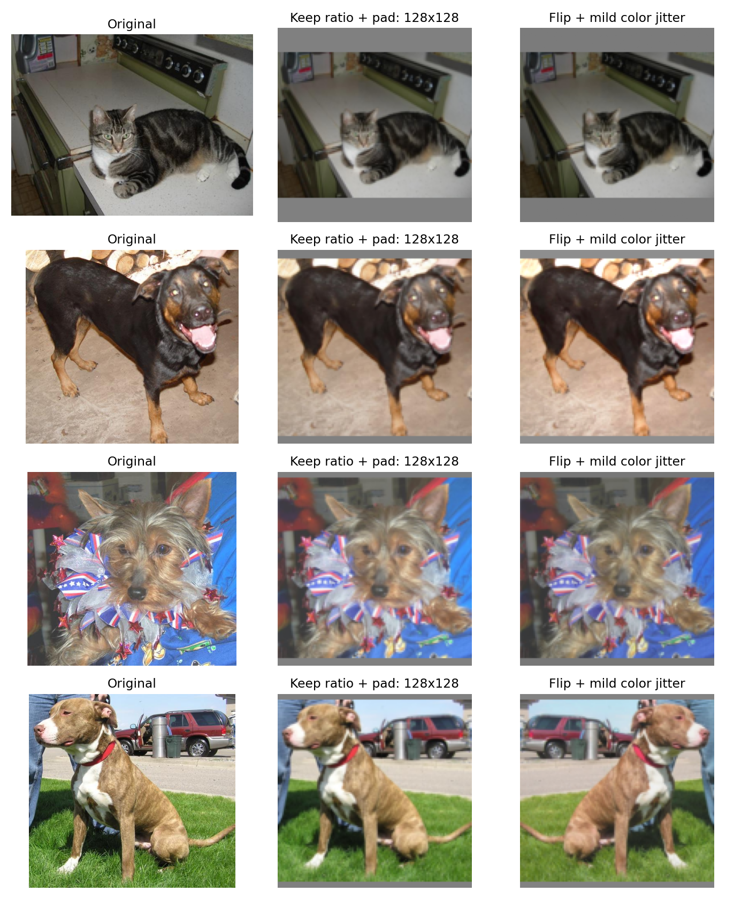

对比中动物形状没有被强行拉长，保留了原图内容。横图的上/下方或竖图的左/右方出现灰边是预期行为。原来的毛色和背景色在普通预处理后保持一致；增强后只有轻微色彩变化和可能的左右翻转。缩小到 128×128 会损失毛发等细节，这是计算成本和细节保留之间的取舍。

## 3. CNN、损失函数与训练方法

模型从头训练，包含四组 `Conv2d(3×3,padding=1) → BatchNorm2d → ReLU → MaxPool2d(2)`。卷积通道依次为 3→16→32→64→128；随后平均池化、展开、全连接 2048→128、ReLU、Dropout(0.3)、全连接 128→2。

ReLU 提供非线性；卷积学习局部形状/颜色/纹理；池化降低空间尺寸和计算量；BatchNorm 稳定中间数值；Dropout 在训练时随机关闭部分全连接特征，减轻过拟合。两个输出是原始 logits，交叉熵 `CrossEntropyLoss` 内部处理分类所需的对数 softmax，训练前不再额外 softmax。

两组均使用 Adam，学习率 0.001，weight decay=0.0001，batch size=128，训练 10 轮。每轮记录训练和验证 loss/accuracy；每组保存验证 loss 最低的一轮。再用两组的验证 loss 选择最终 `best_model.pt`，之后才运行测试。测试集不用来调参或选择模型。

训练 loss/accuracy 是该轮各 batch 在参数不断更新时的汇总，训练时启用 Dropout，增强组还使用随机增强；验证是在轮末、eval 模式、无随机增强下计算。因此训练与验证指标的差异不能全部解释为过拟合。

## 4. 每层 Tensor 形状与结构图

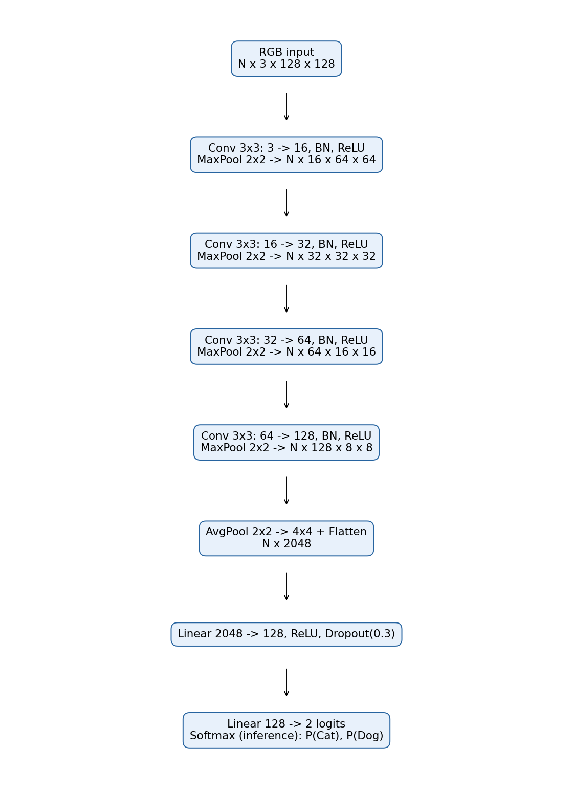

这里实际取测试集的 `Cat/4284.jpg` 经过同一预处理后输入模型，并用前向 hook 记录每层形状。单张图片需要先增加 batch 维度。形状排列是 N、C、H、W，其中 N 为 batch 大小，C 为通道数，H/W 为高/宽。

| 位置 | 单张图片的输出形状 |
|---|---|
| 输入 | [1,3,128,128] |
| 卷积1 → BN → ReLU | [1,16,128,128] |
| 最大池化1 | [1,16,64,64] |
| 卷积2 → BN → ReLU | [1,32,64,64] |
| 最大池化2 | [1,32,32,32] |
| 卷积3 → BN → ReLU | [1,64,32,32] |
| 最大池化3 | [1,64,16,16] |
| 卷积4 → BN → ReLU | [1,128,16,16] |
| 最大池化4 | [1,128,8,8] |
| 平均池化2×2 | [1,128,4,4] |
| Flatten | [1,2048] |
| Linear → ReLU → Dropout | [1,128] |
| Linear | [1,2] |

3×3 卷积的 stride=1、padding=1，使宽高不变，但滤波器个数决定输出通道数。每次 2×2、stride=2 的最大池化使高宽各减半；BN/ReLU/Dropout 不改变形状。完整逐层运行记录位于 `cnn_results/layer_shapes.json`，由前向 hook 实际采集。

## 5. 数据增强对照的设计

唯一改变的主要因素是“是否采用这组增强策略”。基线组不增强；增强组使用概率 0.5 的水平翻转，以及亮度/对比度/饱和度幅度 0.15、色调幅度 0.03 的轻微颜色扰动。两组的数据划分、模型初始化、学习率、优化器、正则化、batch size 与轮数相同。由于同时启用了翻转和颜色扰动，本实验只能评价整个增强组合，不能分离每一种增强的贡献。

水平翻转通常不会改变猫狗类别；轻微颜色扰动模拟光照差异。这些变化能减少模型对固定朝向和颜色条件的依赖。大幅裁剪可能移除动物头部甚至整个动物；强烈色调变换会让颜色失真；大幅旋转或上下翻转可能产生不常见姿势。它们不一定改变物种标签，但可能破坏可供识别的信息或偏离真实分布。本实验因此没有使用激进裁剪或上下翻转。

增强组在第 10 轮取得该组最低验证 loss 0.3502、验证准确率 85.47%；基线第 10 轮的对应数字是 0.2533、89.48%。因此这组增强未提高当前模型的验证表现。原因不能仅凭本次实验确定：128×128 输入已经损失一些细节，增强还可能让有效颜色线索变弱；相同的 10 轮训练量也可能不足以让增强组收敛到最好状态。合理的下一步是单独拆分水平翻转与颜色扰动、增加训练轮数，并多换几个随机种子，而不是据此断言数据增强普遍无效。

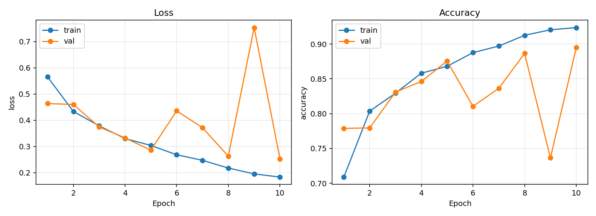

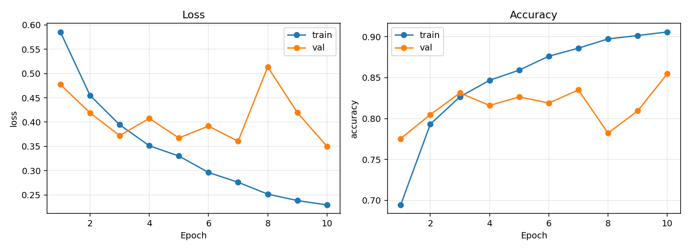

## 6. 指标、速度、显存与测试结果

| 实验 | 验证 loss ↓ | 验证准确率 ↑ | 测试准确率 ↑ | 本阶段耗时 | 稳定轮次训练速度 | 峰值 GPU 已分配显存 |
|---|---:|---:|---:|---:|---:|---:|
| 无增强基线 | 0.2533 | 89.48% | 88.97% | 93.6 秒 | 约 4,920 张/秒 | 503 MiB |
| 水平翻转＋轻度颜色扰动 | 0.3502 | 85.47% | 85.93% | 163.4 秒 | 约 1,994 张/秒 | 503 MiB |
| 基线降低学习率后继续训练 | **0.2371** | **91.13%** | **90.89%** | 45.8 秒（仅续训） | — | 与基线相同的网络 |

稳定轮次训练速度是第 2～10 轮的平均吞吐量；第 1 轮涉及 worker 启动等开销，单独排除。表中总耗时包含每轮验证以及输出图表等工作；续训耗时不包含原基线的 93.6 秒，因此不能直接解释为从零训练更快。训练组 GPU 峰值已分配显存约 503 MiB，峰值预留约 936 MiB，不含显卡上其他程序的占用。增强组 CPU 上的随机变换增加了加载时间，因此 GPU 显存相近但图片吞吐量较低。

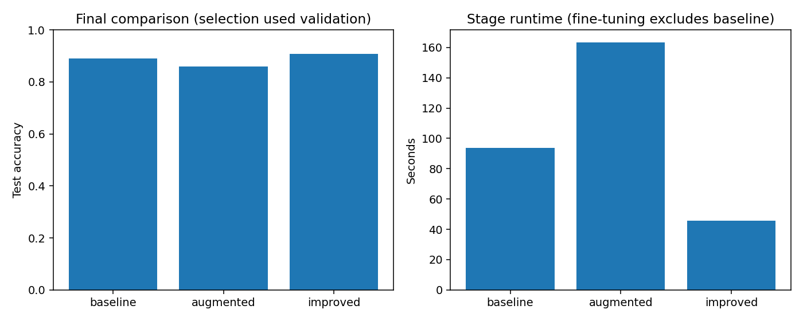

基线的训练 loss 由约 0.565 降到 0.183、训练准确率升到 92.35%；验证曲线却有明显波动，第 9 轮验证 loss 达到 0.753、验证准确率降到 73.65%，第 10 轮又恢复。这提示参数更新或 BatchNorm 统计可能造成阶段性不稳定，不能只看最后一轮或只看训练 loss。续训后训练 loss 继续下降，验证 loss 最低点出现在续训第 1 轮；后续训练 loss 继续降低而验证 loss 波动甚至升高，表明继续优化训练集已不等于提高泛化能力，有过拟合迹象。因此采用最低验证 loss 对应的检查点。

测试集一共 3745 张。最终模型混淆矩阵（行是真值、列是预测）如下：

|  | 预测猫 | 预测狗 |
|---|---:|---:|
| 实际猫 | 1755 | 117 |
| 实际狗 | 224 | 1649 |

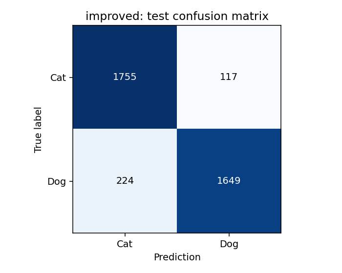

对照基线的混淆矩阵是 `[[1581,291],[122,1751]]`。改进后猫误判为狗由 291 降到 117，但狗误判为猫由 122 升到 224；总体错误数从 413 降到 341。说明总体准确率提升的同时，两类召回率发生了取舍。若应用更重视某一类的漏判，需要基于验证集单独选择阈值或损失权重，而不是只追求总体准确率。完整分类指标、混淆矩阵和逐张预测见各实验目录的 `test_metrics.json` 与 `test_predictions.json`。

## 7. 错误样本、可能原因与实际改进

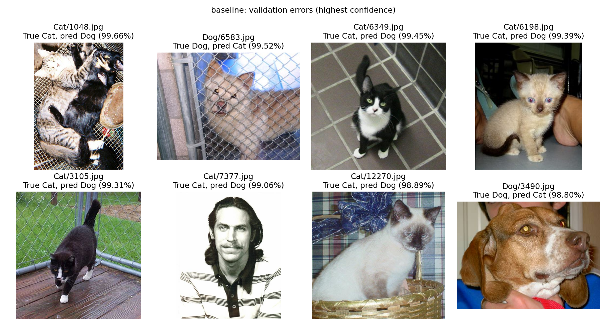

先看验证集：`Cat/1048.jpg` 同时出现猫和狗，按目录标签要求只判“猫”，单标签分类对此并不自然；`Cat/7377.jpg` 基本是一张人像，却位于猫目录，属于明显可疑标签；`Dog/6583.jpg` 的狗被围栏遮挡。这些例子说明部分错误可能来自遮挡、混合动物、标注噪声，不能全部归因于 CNN 太弱。高置信度错判也说明 softmax 数值不等于可靠的真实概率。

基线验证 loss 的大幅起伏提示可以尝试更小的学习率。于是从基线最优检查点继续训练，学习率由 0.001 降到 0.0002，最多 5 轮，仅以验证 loss 选择：续训第 1 轮取得 0.2371 / 91.13%，优于起点 0.2533 / 89.48%；尽管续训第 4 轮验证准确率达到 91.80%，loss 为 0.2524，高于第 1 轮，故按预设规则保存第 1 轮。这个改进是独立于“是否增强”对照的第三个实验，不能拿来证明数据增强的作用。

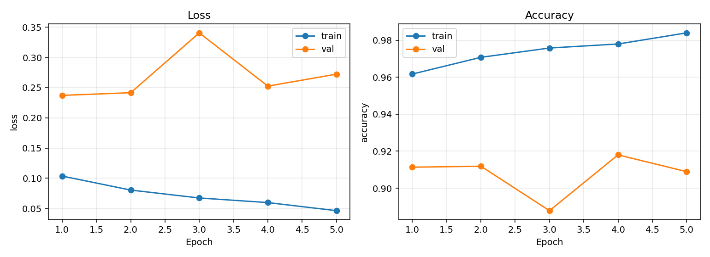

最后查看测试集的高置信度错误：`Dog/562.jpg` 的脸被铁丝网挡住；`Dog/561.jpg` 原图低分辨率且模糊；`Dog/11663.jpg` 小狗只占画面一角，大部分区域是人和沙发；`Cat/5355.jpg` 一张图里同时有狗和白猫；`Cat/2126.jpg` 两只黑猫挤在一起，身体轮廓难分。这里的原因是图像观察后提出的可能解释，并没有通过遮挡实验逐项证明。后续可人工复核可疑标签、过滤混合动物样本，或尝试更高输入分辨率和目标区域定位；这些建议尚未作为本实验结果宣称有效。

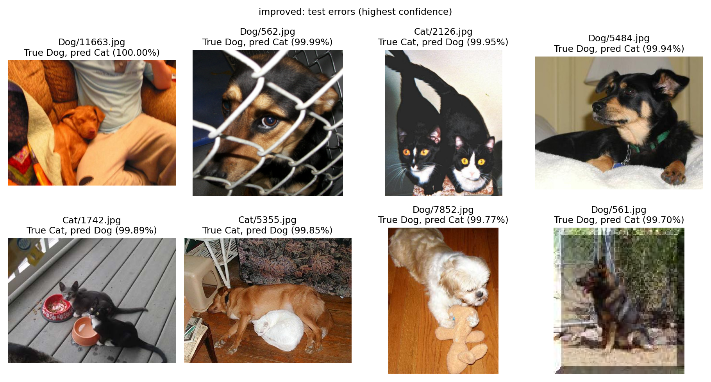

模型选择始终根据验证集 loss。测试集只用于已定模型的最后报告；查看测试错例后的建议没有再用于调本次最终模型。

## 8. 卷积特征图观察

从测试集按固定种子抽出两张猫、两张狗，对每张图分别显示第一层及最后一层卷积结果中空间变化较大的 8 个通道。

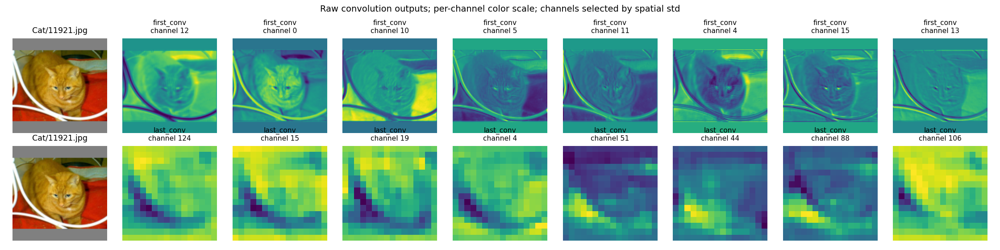

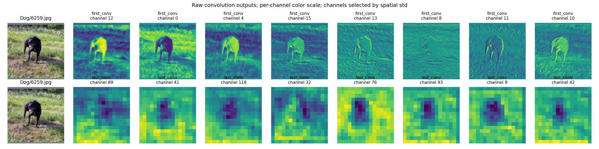

在 `Cat/11921.jpg` 的第一层，不同通道对黄猫身体、眼鼻附近、白色电线边缘以及红色背景的反应不同；在 `Dog/6259.jpg`，有的通道突出狗的轮廓，有的通道对草地纹理也很敏感。由此可以观察到不同滤波器对局部颜色、亮度变化和边缘/纹理的响应各异。最后一层卷积图只有 8×8，区域更粗，通道之间会对不同空间区域产生不同响应；它可能整合了更复杂的纹理/部位信息，但仅凭这些热图不能断言某个通道专门识别“耳朵”或“猫”。

图中展示的是 ReLU 之前的原始卷积输出；每张通道图单独映射颜色。因此能比较一张通道图内部哪些位置相对更强，不能直接拿两个通道的颜色深浅比较绝对激活大小。灰色补边在部分通道出现响应，是预处理引入的边界效应。另两张测试图片及抽样文件名记录在 `cnn_results/features_2.png`、`features_4.png` 和 `feature_samples.json`。

## 9. 模型保存与独立推理

`cnn_results/best_model.pt` 保存最终选择的模型权重、类别顺序、输入尺寸、归一化参数和预处理说明。`predict_catdog.py` 可独立读取任意本地图片，按训练时相同的“RGB → 按比例缩放补边 → Tensor → 归一化”流程生成 `[1,3,128,128]`，输出“猫/狗”、两类概率及 `prediction/processed.png`。例如：

```powershell
python predict_catdog.py --image "F:\焦糖工作室招新\Jotang-ml-task2\data\PetImages\Dog\6259.jpg"
```

这张用于功能验证的测试集狗图片输出“狗”，狗的 softmax 约为 99.9996%，并成功保存了处理后图片。它只是单张程序运行示例，模型性能应看完整测试集指标，而不是这张图片的预测。程序对非猫狗图片也会强制选一类，使用时要注意其应用范围。

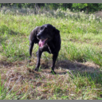
