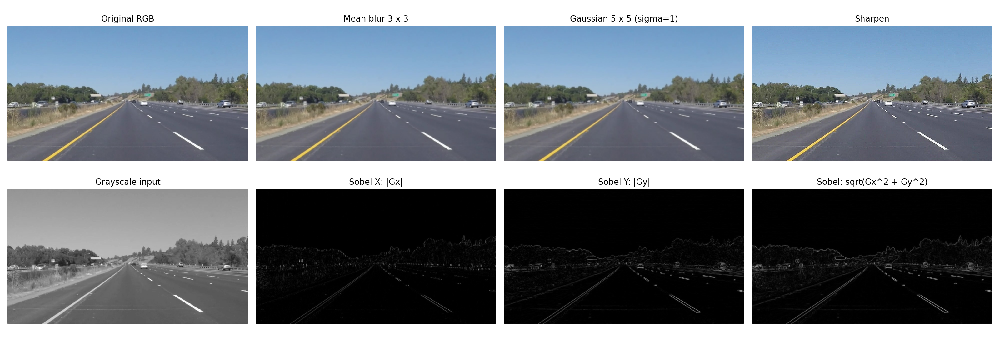
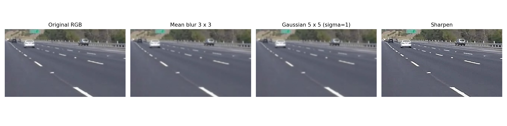

# 手写卷积核处理同一张图片

输入是本项目的 `image/img.png`，不缩放输入。运行 `python filter_comparison.py`，结果保存到 `filter_results`。脚本调用 `numpy_convolution.py` 的手写循环，没有使用现成滤波函数；Pillow负责图片读写，Matplotlib负责排版。





## 卷积核与作用

1. **3×3均值模糊**：九个元素均为1/9，输出是邻域平均值。平滑纹理和噪声，同时使车道线、树木等细节变模糊。
2. **5×5高斯模糊**：用 `exp(-(x²+y²)/(2σ²))` 生成，σ=1，最后除以元素总和，使核的和为1。中心权重大、外围权重小。这里核大小和权重都与均值核不同，不应简单把差异只归因于高斯形式。
3. **锐化**：使用 `[[0,-1,0],[-1,5,-1],[0,-1,0]]`。增强中心与邻域的差异，使边界更突出，也可能放大噪声、产生亮暗光晕。显示时裁剪到0～255，原始结果不裁剪。
4. **Sobel边缘检测**：先用 `0.299R+0.587G+0.114B` 转浮点灰度，再计算两个方向。

```text
Sobel-X           Sobel-Y
-1  0  1          -1 -2 -1
-2  0  2           0  0  0
-1  0  1           1  2  1
```

Gx检测沿水平方向的亮度变化，对竖向边缘更敏感；Gy检测沿竖直方向的变化，对横向边缘更敏感。斜线可能同时在两个方向有响应。使用 `sqrt(Gx²+Gy²)` 合成边缘幅值，而不是直接相加，避免正负梯度相互抵消。

## 显示与边界处理

- 均值、高斯、锐化对RGB三个通道分别计算；Sobel使用灰度。
- 步长均为1，使用same零填充，输出高宽与输入相同。零填充会使图像外缘出现暗边或额外边缘响应，这是边界处理效应，不代表原图有黑色轮廓。
- 采用 `flip_kernel=False`（互相关，即深度学习常见约定）。前三种对称核翻转后不变；Sobel核若翻转，Gx/Gy符号反向，但绝对值和合成幅值不变。
- 浮点梯度有正负号，不能直接转uint8。两张方向图显示绝对值；三张边缘图统一除以合成幅值最大值并乘255，使用相同的显示比例。
- 原始浮点输出保存在 `raw_results.npz`，卷积核保存在 `kernels.json`，shape、dtype和最值保存在 `statistics.json`。
- 这只是图像滤波，不涉及模型训练。均值和高斯图更平滑、锐化图边界更强、Sobel图突出亮度变化，不能把不同处理目标统一理解为“哪个准确率更高”。
