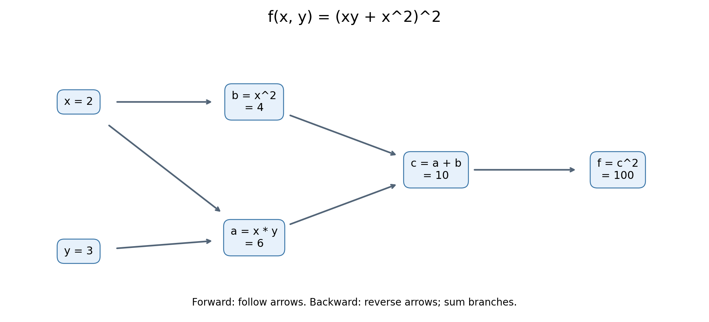

# 实践 1：简单计算链

函数为 $f(x,y)=(xy+x^2)^2$。选取 **x=2，y=3**。本实验没有随机操作，因此不需要设置随机种子；相同输入会得到相同结果。

## 1. 拆解计算过程与计算图

| 步骤 | 运算 | 数值 |
| --- | --- | --- |
| 1 | a = x × y | 2 × 3 = 6 |
| 2 | b = x² | 2² = 4 |
| 3 | c = a + b | 6 + 4 = 10 |
| 4 | f = c² | 10² = 100 |



图中的箭头表示前向计算时的数据依赖。反向传播时，沿箭头的反方向计算梯度。特别注意：x 同时参与了 a 和 b 的计算，所以有两条路径影响最终结果。

## 2. 从后向前计算梯度

梯度可以理解为：输入发生微小变化时，输出会以多快的速度变化。反向传播用链式法则，把沿途的局部导数相乘；遇到分支汇合，则把各条路径的贡献相加。

从最终输出出发：

$$\frac{\partial f}{\partial f}=1$$

因为 f=c²：

$$\frac{\partial f}{\partial c}=1\times 2c=20$$

因为 c=a+b，加法对两个输入的局部导数都是 1：

$$\frac{\partial f}{\partial a}=20\times1=20,\qquad
\frac{\partial f}{\partial b}=20\times1=20$$

x 通过乘法分支 a=xy 贡献：

$$\left.\frac{\partial f}{\partial x}\right|_{a}=20\times y=60$$

x 通过平方分支 b=x² 贡献：

$$\left.\frac{\partial f}{\partial x}\right|_{b}=20\times 2x=80$$

将两条路径相加，而不是只保留其中一条：

$$\boxed{\frac{\partial f}{\partial x}=60+80=140}$$

y 只通过乘法分支影响输出：

$$\boxed{\frac{\partial f}{\partial y}=20\times x=40}$$

整理为一般公式也可以核对：

$$\frac{\partial f}{\partial x}=2(xy+x^2)(y+2x),\qquad
\frac{\partial f}{\partial y}=2(xy+x^2)x$$

NumPy 实现在 `main.py` 的 `numpy_forward_backward()` 中。NumPy 没有在这里自动求导，每一步局部导数都是我们根据上述计算图手写的。`dx += ...` 用来累加 x 的两条路径，漏掉一次累加就会得到错误结果。

## 3. 用 PyTorch autograd 检查

`torch_forward_backward()` 直接计算原函数，并执行：

```python
x_tensor = torch.tensor(2.0, dtype=torch.float64, requires_grad=True)
y_tensor = torch.tensor(3.0, dtype=torch.float64, requires_grad=True)
f_tensor = (x_tensor * y_tensor + x_tensor ** 2) ** 2
f_tensor.backward()
```

`requires_grad=True` 让 PyTorch 跟踪运算。`backward()` 从标量输出开始，自动应用链式法则；结果分别保存在 `x_tensor.grad` 和 `y_tensor.grad`。

本例没有优化器，也没有参数更新，只进行一次前向计算与一次反向传播。每次调用都新建输入 Tensor，所以不会累积上一次调用的梯度。

| 结果 | NumPy 手动计算 | PyTorch autograd |
| --- | ---: | ---: |
| f | 100 | 100 |
| ∂f/∂x | 140 | 140 |
| ∂f/∂y | 40 | 40 |

脚本使用 float64，并通过 `np.testing.assert_allclose` 检查结果；容许的相对误差与绝对误差均为 `1e-12`。

## 运行方法

在已安装 NumPy、PyTorch、Matplotlib 的 Python 环境中，在本目录运行：

```bash
python main.py
```

也可以换一组输入：

```bash
python main.py --x 1.5 --y -2
```

程序打印每一步的数值、手动梯度和 PyTorch 梯度，核对通过后输出 `PASS`，并将该组输入对应的计算图保存为本目录的 `computation_graph.png`。重新运行会更新这张图；不带参数运行即可恢复本文的默认示例。

## 后续：两层二分类网络的反向传播

实践 2 使用独立脚本 `mlp_backward.py`，运行方式为 `python mlp_backward.py`。

- [数据、形状、计算图和链式法则推导](mlp_backward_notes.md)
- [实际运行的逐项梯度对照结果](mlp_gradient_results.md)
- [网络计算图](mlp_computation_graph.png)

# 反向传播思考题

## 1. 前向传播为什么保存输入或输出？与显存有什么关系？

反向传播需要使用前向计算时的数值，才能求出各个运算的局部导数。结合本次两层网络：

| 运算 | 反向传播会用到的前向数值 | 用途 |
| --- | --- | --- |
| z1 = X @ W1 + b1 | X、W1 | dW1 = X.T @ dz1；dX = dz1 @ W1.T |
| a1 = ReLU(z1) | z1 的正负信息 | dz1 = da1 × (z1 > 0) |
| z2 = a1 @ W2 + b2 | a1、W2 | dW2 = a1.T @ dz2；da1 = dz2 @ W2.T |
| p = Sigmoid(z2) | p | Sigmoid 的局部导数为 p(1-p) |
| BCE(p,y) | p、y | 计算损失对预测概率的导数 |

不是每个运算都必须保存完整的输入和输出。例如 ReLU 反向只需要知道哪些位置大于 0；加法的局部导数是常数 1，不需要输入的具体数值，但仍需知道广播和形状信息。本次 NumPy 代码为了便于学习，显式保存了较完整的中间结果；PyTorch 会根据算子的反向计算需要保存相应信息。

这些数值在 GPU 上就要占显存。batch 越大、网络越深、中间特征图越大，通常需要保存的激活值也越多。训练占用还包括参数、梯度以及可能存在的优化器状态，因此参数数量不能代表全部显存需求。

`retain_grad()` 的含义是额外保留中间 Tensor 的梯度，便于查看；它不同于 autograd 为计算反向传播保存前向数值。正常反向传播不需要我们给每一层调用 `retain_grad()`。本实验为了逐项对照，才这样做。

通常一次 backward 后，为这次反向计算保存的中间缓冲会被释放；叶子 Tensor 的 `.grad` 等仍可能保留。使用 `retain_graph=True` 会保留更多计算图相关信息以支持再次反传，也会增加内存占用。本实验实际使用 CPU，没有测量 GPU 显存，上述是机制解释。

## 2. 链式法则怎样把梯度传回第一层权重？

本次计算路径为：

```text
X → z1 → a1 → z2 → p → 每个样本的 BCE → 平均损失 L
    ↑         ↑
  W1,b1     W2,b2
```

前向传播沿箭头计算数值；反向传播从 L 开始，把上游梯度乘以当前运算的局部导数，逐步传回去。令 N 为样本数、隐藏层宽度为 3：

```python
dz2 = (p - y) / N                  # (N,1)
da1 = dz2 @ W2.T                   # (N,1)@(1,3) -> (N,3)
dz1 = da1 * (z1 > 0)               # (N,3)，经过 ReLU 的局部导数
dW1 = X.T @ dz1                    # (2,N)@(N,3) -> (2,3)
```

因此第一层权重梯度可以写成：

$$\frac{\partial L}{\partial W_1}
=X^T\left[\left(\frac{p-y}{N}W_2^T\right)\odot\mathbf{1}_{z_1>0}\right]$$

其中 ⊙ 表示逐元素相乘。这里的矩阵乘法已经包含对相关路径的求和，不能把所有步骤都替换成逐元素乘法。

例如单样本实验中，第 1 个隐藏神经元的 z1 约为 -0.20478，被 ReLU 截成 0。该路径的梯度也被截断，因此这个样本对 W1 第 1 列及 b1 第 1 个分量的梯度贡献为 0。其余两个神经元的 z1 大于 0，可以继续传递梯度。

第一项简单计算链同样说明了分支累加：x 同时出现在 xy 和 x² 中，最终梯度必须把两条路径的贡献相加，得到 60+80=140。

## 3. BCE 与 Sigmoid 配合后，loss 对 logit 的梯度是什么？

logit 是 Sigmoid 之前的数值，本网络中就是 z2。对单个样本，设 p=Sigmoid(z)，二元交叉熵为：

$$\ell=-[y\log p+(1-y)\log(1-p)]$$

分别求导：

$$\frac{\partial\ell}{\partial p}=-\frac{y}{p}+\frac{1-y}{1-p},\qquad
\frac{\partial p}{\partial z}=p(1-p)$$

应用链式法则，得到：

$$\boxed{\frac{\partial\ell}{\partial z}=p-y}$$

本实验对 N 个样本取平均，因此：

$$\boxed{\frac{\partial L}{\partial z_i}=\frac{p_i-y_i}{N}}$$

这个结果只需要预测概率减去标签，便可传给最后一个线性层，公式短、容易检查。它也避免在手算最终表达式时分别处理 1/p 与 1/(1-p) 等项。若直接使用这个化简结果，就已经包含了 Sigmoid 的导数，不能再额外乘一次 p(1-p)。

例如单样本实验中，p≈0.46646369、y=1，所以 dz2≈-0.53353631。负梯度表示若直接对该 logit 做梯度下降，会让它增大，从而提高类别 1 的概率。

这里要区分代数简化与实际数值稳定性：单独计算 Sigmoid 和 log 仍可能在极端 logit 下发生数值问题。本实验的参数较小，未出现这种情况。

## 4. NumPy 与 PyTorch 梯度不一致时，怎样定位原因？

先固定相同的 X、y、参数、浮点类型和损失定义，再按以下顺序排查。

**先比前向值。** 逐项检查 z1、a1、z2、p、loss。若前向已经不同，先找第一次不同的位置；这时通常不是反向公式的问题。

**再比形状。** 本例四组参数及梯度应分别为 `(2,3)`、`(1,3)`、`(3,1)`、`(1,1)`。形状不匹配时，不要先用 reshape 强行凑出结果。

| 现象 | 优先检查 | 本实验中的具体检查 |
| --- | --- | --- |
| 矩阵乘法报维度错误，或梯度形状颠倒 | 转置和权重约定 | dW1 应为 X.T @ dz1；F.linear 使用转置后的权重 |
| 输出突然多出一个维度，或出现 (N,N) | 广播 | y 与 p 都必须为 (N,1)，不能一个是 (N,) |
| 偏置梯度成了 (N,3)，或数值重复平均 | 广播的反向归约 | db1 对样本维求和并保留 (1,3)；1/N 已在前面计入 |
| 单样本正确，batch 梯度却稳定相差 N 倍 | mean 与 sum | 检查是否漏除 N、重复除 N，或两边 reduction 不同 |
| ReLU 负数位置仍传递梯度 | 激活函数导数 | 检查是否乘了 (z1 > 0)，以及零点约定是否一致 |
| 形状与前向都对，但反向从某层开始不同 | 局部导数或链式法则 | 从 loss 向前依次比较 dp、dz2、da1、dz1 |
| 只有约 1e-17 的微小误差 | 浮点舍入 | 看最大绝对误差与 allclose，而不是要求逐位完全相等 |

这些是排查线索，不能仅凭一个现象就断定原因。例如有些错误的广播不会立刻触发异常，必须同时看数值和形状。

还可以用中心差分独立检查某个参数 θ：

$$\frac{\partial L}{\partial\theta}\approx
\frac{L(\theta+\varepsilon)-L(\theta-\varepsilon)}{2\varepsilon}$$

例如使用 float64 和 ε=1e-6 作为起点，每次只扰动一个分量，并在计算后还原参数。若扰动跨过 ReLU 的零点，有限差分可能与选定的零点导数不同，需避开该位置或调整扰动。此方法是后续排错建议，本次脚本没有执行有限差分。

本次实际验证中，单样本所有梯度最大绝对误差为 0；4 个样本的全部梯度最大绝对误差约为 5.55e-17，均通过检查，属于浮点计算允许的差异。

## 5. 完成两次验证后，怎样理解 loss.backward()？

`loss.backward()` 可以理解为：从损失出发，按照前向计算建立的依赖关系，自动完成我们用 NumPy 手写的链式法则运算。

更准确地说，工作分为两个阶段：

1. **前向阶段：** 开启梯度跟踪时，autograd 记录运算之间的依赖，并根据需要保存前向 Tensor、形状等信息。计算图不是调用 backward 后才开始建立的。
2. **反向阶段：** 对标量 loss，backward 从梯度 1 出发，按反向依赖顺序调用各个运算的求导规则，传播梯度；对分支贡献求和，并处理广播对应的归约，将结果累加到需要求导的叶子 Tensor 的 `.grad` 中。

它替我们完成了矩阵乘法求导、ReLU 掩码、Sigmoid 与 BCE 求导、均值的 1/N，以及共享参数和分支梯度的累加。本次代码调用 `retain_grad()` 后，也能查看中间 Tensor 的梯度。

第一项实验验证了简单计算链和分支累加；第二项验证了多层矩阵运算、非线性函数和 batch 求平均。因此 backward 可以处理完整网络，而不只是对一个单独的公式求导。

`backward()` 不会清空上一次的梯度，也不会更新参数。若在常规训练循环中不清空叶子参数的 `.grad`，梯度会累积。本实验每次都重新创建 Tensor，因此不带入上一轮梯度，也没有调用优化器更新参数。默认情况下，一次 backward 后保存的反向缓冲通常已释放，不能直接对同一张图反复 backward；应重新前向计算，或在确有需要时保留计算图。

## 6. 实际情况与容易混淆的知识点记录

**实际发生的情况：** 本次两层网络脚本运行时没有出现 Python 异常，前向结果和全部梯度均验证通过。最初尝试取数据前 4 个样本时，发现它们的标签恰好全是 1。这不是程序错误，但没有覆盖标签 0 的情况，因此将小 batch 改为固定索引 `[0,1,4,9]`，对应标签 `[1,1,0,0]`，重新验证也通过了。

以下是本实验需要理解、已在代码和笔记中说明的知识点；它们不是已发生的报错，也不代表本人此前实际遇到过对应异常：

- **为什么标签要 reshape？** 让 y 的形状和 p 一致，避免 `(N,)` 与 `(N,1)` 广播成 `(N,N)`。
- **为什么 PyTorch 权重要转置？** 本次 NumPy 使用 `(输入数,输出数)`，F.linear 接收的是 `(输出数,输入数)`。
- **为什么偏置梯度求和？** 同一个偏置用于多个样本，反向时要合并这些使用位置的贡献；mean 的 1/N 已经从 loss 传下来了。
- **为什么有些参数梯度为 0？** 当前样本对应的 ReLU 路径可能被关闭，不一定是计算出错，也不意味着该参数对所有样本的梯度永远为 0。
- **为什么中间 Tensor 要 retain_grad？** 默认不会把中间节点的梯度都保存到 `.grad`；为了显示并比较它们，才额外保留。
- **为什么不能要求误差严格等于 0？** 运算顺序等因素会造成微小的浮点舍入差异，应结合误差大小与容差判断。

后续若出现真实报错，应记录完整报错信息、对应代码、输入形状、原因、修改方法和修改后的验证结果，再补充到这里。
