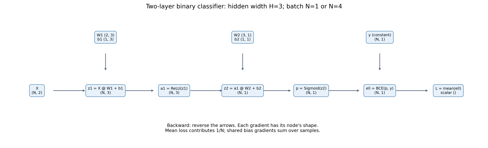

# 实践 2：两层二分类网络的手动反向传播

运行 `python mlp_backward.py`，先完成一个样本的前向与反向传播，再换为 4 个样本。脚本不更新参数，不进行模型训练。

## 数据与参数

沿用 Task 1 基准实验的数据生成方式：

```python
X_all, y_all = make_moons(n_samples=1000, noise=0.2, random_state=42)
```

单样本使用生成结果的第 0 个样本；小 batch 使用索引 `[0, 1, 4, 9]`，对应标签 `[1, 1, 0, 0]`。因为原始前 4 个样本恰好全是类别 1，这样选可以让两个类别都参与 BCE 的梯度检查。两者直接使用原始二维坐标，Task 1 的基准代码也未进行标准化。这里不导入 Task 1 的训练脚本，避免启动完整训练。只检查梯度，不评价泛化性能，因此无需再划分训练集、验证集和测试集。

隐藏层选 3 个神经元。参数直接指定，便于观察每一个数值，不涉及随机初始化：

```text
W1 = [[ 0.4, -0.3, 0.2],
      [-0.5,  0.6, 0.1]]       shape=(2,3)
b1 = [[0.1, -0.2, 0.05]]      shape=(1,3)
W2 = [[0.7], [-0.4], [0.3]]   shape=(3,1)
b2 = [[-0.1]]                shape=(1,1)
```

使用 CPU 和 float64 降低浮点舍入误差。标签 0/1 对应 make_moons 的两个类别；Sigmoid 的输出 p 表示类别 1 的预测概率。

## 前向计算图与形状



其中 N 是 batch 中的样本数，H=3。箭头表示前向依赖；从最终 loss 沿箭头反向计算梯度。W1、b1、W2、b2 和标签 y 也是图中相应运算的输入。

| 变量 | 前向公式 | N=1 时的形状 | N=4 时的形状 |
| --- | --- | --- | --- |
| X | 二维输入 | (1,2) | (4,2) |
| y | 标签列向量 | (1,1) | (4,1) |
| W1 | 第一层权重 | (2,3) | (2,3) |
| b1 | 第一层偏置 | (1,3) | (1,3) |
| z1 | X @ W1 + b1 | (1,3) | (4,3) |
| a1 | maximum(z1, 0) | (1,3) | (4,3) |
| W2 | 第二层权重 | (3,1) | (3,1) |
| b2 | 第二层偏置 | (1,1) | (1,1) |
| z2 | a1 @ W2 + b2 | (1,1) | (4,1) |
| p | 1 / (1 + exp(-z2)) | (1,1) | (4,1) |
| ell | 每个样本的 BCE | (1,1) | (4,1) |
| L | mean(ell) | 标量 () | 标量 () |

`@` 表示矩阵乘法；`*` 表示逐元素相乘。偏置沿样本维广播，相当于每个样本加上同一组偏置。所有待求导变量的梯度都与该变量本身形状相同。y 是固定标签，不对它求梯度。

二元交叉熵与 batch 平均损失为：

$$\ell_i=-[y_i\log p_i+(1-y_i)\log(1-p_i)],\qquad
L=\frac{1}{N}\sum_{i=1}^{N}\ell_i$$

本例输入、权重较小，概率远离 0 和 1，因此直接计算 Sigmoid 与 BCE 即可；没有使用会改变导数的概率裁剪。

## 按链式法则反向传播

下面用 `d变量` 表示最终损失 L 对该变量的导数，例如 `dW1` 是 ∂L/∂W1。

**1. 均值与 BCE：**

```python
dL = 1                                       # ()
dell = ones_like(p) / N                       # (N,1)
dp = dell * (-y/p + (1-y)/(1-p))              # (N,1)
```

均值运算让每个样本的损失都乘上 1/N。注意标签必须由 `(N,)` 变为 `(N,1)`，否则与 `(N,1)` 的预测值运算时可能错误广播成 `(N,N)`。

**2. Sigmoid：**

```python
dz2 = dp * p * (1-p)                         # (N,1)
```

Sigmoid 的局部导数是 p(1-p)。将前两步合并可化简为 `dz2 = (p-y)/N`。脚本保留拆开的两步，并核对化简公式。

**3. 第二个线性层：**

```python
dW2 = a1.T @ dz2                             # (3,N)@(N,1) -> (3,1)
db2 = dz2.sum(axis=0, keepdims=True)          # (1,1)
da1 = dz2 @ W2.T                             # (N,1)@(1,3) -> (N,3)
```

每个样本都使用相同的 W2 和 b2，因此这些共享参数需要累加所有样本的贡献。1/N 已在前面计入，偏置梯度此处求和即可，不能再次求平均。

**4. ReLU：**

```python
dz1 = da1 * (z1 > 0)                         # (N,3)
```

正数位置的局部导数为 1，负数位置为 0，所以负数位置的梯度被截断。在 z1=0 处不可导，本例约定导数为 0，与 PyTorch 一致。

**5. 第一个线性层：**

```python
dW1 = X.T @ dz1                              # (2,N)@(N,3) -> (2,3)
db1 = dz1.sum(axis=0, keepdims=True)          # (1,3)
dX = dz1 @ W1.T                              # (N,3)@(3,2) -> (N,2)
```

虽然题目只要求参数梯度，脚本也计算 dX 和中间变量的梯度，方便逐步核对。dX 只是导数，不会修改输入。

## PyTorch 如何保持完全一致

NumPy 采用 `X @ W`，权重形状为 `(输入数, 输出数)`。PyTorch 的 `F.linear` 使用 `X @ weight.T`，其 weight 形状为 `(输出数, 输入数)`，因此传入 `W1.T` 和 `W2.T`。这样两者执行相同的线性变换，叶子变量 W1/W2 的形状也保持一致。

PyTorch 依次执行 `F.linear → torch.relu → F.linear → torch.sigmoid → BCE → mean`，只调用一次 `loss.backward()`。每次实验都复制相同参数并新建 Tensor，避免上次梯度的累积。对于中间 Tensor，调用 `retain_grad()` 保留梯度以供检查。

`mlp_gradient_results.md` 由实际运行自动生成，包含全部输入、参数、中间数值、各项梯度的形状和两套梯度的完整数值，以及最大绝对误差和 PASS/FAIL。

对每一项，最大绝对误差为 `max(abs(NumPy梯度 - PyTorch梯度))`。使用 `np.testing.assert_allclose` 自动检查，容许相对误差为 `1e-10`，绝对误差为 `1e-12`；只要一项不匹配，程序就会报错。浮点结果不必逐个二进制位相同。

## 从单样本到小 batch：什么改变了

输入、标签、各层中间结果及其梯度的第一个维度由 1 变成 4；参数及其梯度形状不变，最终 loss 仍是标量。矩阵公式保持不变，但均值损失的 1/N 从 1 变为 1/4，偏置需要汇总 4 个样本的贡献。

固定参数时，4 个样本的平均 loss 对共享参数的梯度，等于对这 4 个样本分别计算单样本梯度后再取平均。脚本对 W1、b1、W2、b2 都验证了这一点。单样本实验只是 batch 第 0 个样本，不能直接期待它的参数梯度等于整个 batch 的梯度。

脚本还检查计算前后的参数数组完全相同，确认本实验只计算导数，没有进行更新。

## 本次运行结果

单样本的全部梯度最大绝对误差为 0；4 个样本时，四组参数梯度中的最大绝对误差约为 `1.39e-17`，包括输入与中间节点在内的全部梯度最大绝对误差约为 `5.55e-17`。两种 batch 大小的前向值与全部梯度均通过检查。4 个单样本参数梯度取平均与 batch 参数梯度一致的检查也通过了。
